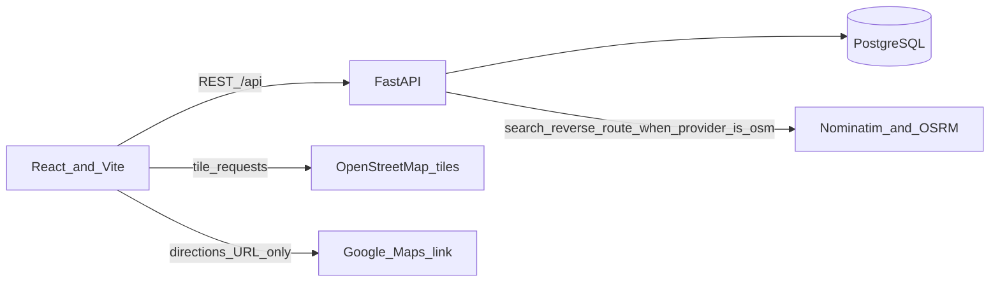
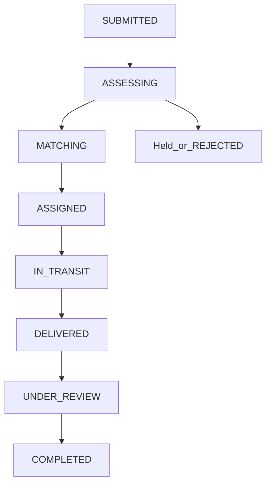

# Anuvartan

### Pass It Forward.

Anuvartan helps surplus food and everyday resources move toward verified local destinations instead of being unnecessarily discarded.

A donor records what they can give, where it can be picked up, and when. A volunteer can accept a short-lived pickup offer and carry the donation. A receiving organisation can review intake. An administrator can verify organisation accounts and read the audit log.

The product goal lines up with **UN SDG 12 — Responsible Consumption and Production**: keep usable food and goods in use, and record the handoff instead of treating disposal as the default.

This repository is the current Anuvartan application (React frontend and FastAPI backend). It is not a git repository yet, so there is no remote URL to clone from in the project metadata.

## Contents

- [Key features](#key-features)
- [User roles and workflow](#user-roles-and-workflow)
- [Screenshots](#screenshots)
- [Technology stack](#technology-stack)
- [Architecture](#architecture)
- [Repository structure](#repository-structure)
- [Prerequisites](#prerequisites)
- [Local setup](#local-setup)
- [Environment variables](#environment-variables)
- [Database and migrations](#database-and-migrations)
- [Maps and location](#maps-and-location)
- [OTP and handover](#otp-and-handover)
- [API](#api)
- [Security and privacy](#security-and-privacy)
- [Testing](#testing)
- [Troubleshooting](#troubleshooting)
- [Limitations](#limitations)
- [Facility data](#facility-data)
- [Deployment](#deployment)
- [Contributing](#contributing)
- [Licence and acknowledgements](#licence-and-acknowledgements)

## Key features

Implemented in the current code:

- Registration and login for donor, volunteer, driver, organisation, farm/recovery partner, and admin roles. Passwords are hashed. Sessions use a short-lived JWT and an HttpOnly cookie.
- Donation creation with category, quantity, pickup coordinates, and status history.
- Food rules: ordinary cooked leftovers are refused. Sealed dry rations and a private catered function (25 or more, with a caterer name) can be submitted after a donor declaration. "Not sure" and some time windows hold the donation for review instead of dispatching it.
- Books, clothes, toys, and miscellaneous (`OTHER`) donations require a future pickup date and time window. ASAP is rejected by the API as well as the form.
- Volunteers keep the volunteer role and can also submit donations. Those donations appear under **My donations**. They are not offered back to the same volunteer as a pickup they can claim.
- Timed volunteer offers (default 10 seconds), atomic accept, and a separate active-assignment view.
- Pickup and delivery OTP checks. Codes are hashed, expire, and allow a limited number of attempts. Delivery to the user is in-app only.
- Leaflet maps on OpenStreetMap tiles. Search and reverse geocoding go through the backend. Road routing is requested from the configured provider and is omitted when that call fails.
- Google Maps direction links built from real coordinates. If the browser has no GPS fix, the origin is left out.
- A facility directory imported from a research workbook. Listings can be ranked by straight-line distance. They are not treated as confirmed Anuvartan destinations.
- Photo upload for a donation (JPEG, PNG, or WebP, up to 5 MB). A local visual check can run in the browser. It is not a safety certificate.
- Points recorded after a verified delivery. The reward catalog is not redeemable.
- Admin endpoints for organisation verification, recovery-partner verification, an operations map, and the audit log.

Partial or not operational:

- External SMS or email delivery of OTP codes. No provider is configured. The issue response states that SMS was not sent.
- Organisation confirmation of a directory facility. A donor preference and a volunteer proposal are stored. They do not set a confirmed destination.
- Road distance and travel time. Recommendations are straight-line kilometres. A dashed map line without a routing result is a preview, not a driven route.
- Admin review of imported facilities on a map. Verification in the admin API applies to organisation accounts, not to every workbook row.
- `docs/MAPS_AND_LOCATION.md` still describes Mappls as the primary map layer. The running default is OpenStreetMap (`MAP_PROVIDER=osm`, `VITE_MAP_PROVIDER=leaflet`). Mappls code remains and is used only when those settings are changed and credentials are present.

## User roles and workflow

| Role | What the account can do |
| --- | --- |
| Donor | Submit and track their own donations, choose a facility preference, issue a pickup OTP. |
| Volunteer | See other people's pickup offers, accept one assignment, propose a facility, enter the donor's pickup OTP. The same account can also donate. |
| Driver | Uses the same offer and assignment APIs as a volunteer. Cannot create household donations. |
| Organisation | Update their organisation profile and verify a delivery OTP when they are the receiving party. |
| Farm operator | Recovery-partner account. Separate from household donation matching. |
| Admin | Verify organisations and recovery partners, read the audit log and operations map, transition donation status. |

One account has one stored role. A volunteer is not converted into a donor when they give something. Donation ownership is the user id on the donation.

A submitted donation is not automatically assigned. Eligible food and goods move to `MATCHING` when safety checks allow it. Volunteers receive a server-timed offer. Accepting that offer creates one assignment. A second accept of the same donation is rejected.

Persisted donation statuses include `SUBMITTED`, `ASSESSING`, `MATCHING`, `MATCHED`, `ASSIGNED`, `PICKUP_PENDING`, `IN_TRANSIT`, `DELIVERED`, `UNDER_REVIEW`, `ACCEPTED`, `REJECTED`, `COMPLETED`, `CANCELLED`, and `EXPIRED`, plus recovery statuses `RECOVERY_PENDING`, `RECOVERY_ASSIGNED`, and `RECOVERED`. The API exposes a short label for each. Allowed transitions are enforced in `backend/app/services/status.py`.

Typical path when the checks pass:

1. Donor submits. Status becomes `SUBMITTED`, then `ASSESSING`.
2. If the donation is eligible, it enters `MATCHING` and offers are issued.
3. A volunteer accepts. Status becomes `ASSIGNED`.
4. The donor issues a pickup code in the app. The assigned volunteer submits it. Status becomes `IN_TRANSIT`.
5. The receiving organisation issues and verifies a delivery code. Status becomes `DELIVERED`.
6. Later review can move the donation to `ACCEPTED` and then `COMPLETED`. That last step is not automatic.

Food that fails the donor checks is rejected. Food that is uncertain is held and is not offered.

## Screenshots

There are no interface screenshots in this repository. Useful ones to add later, after they are captured from a running session:

- Landing page
- Donation form
- Pickup map with the house pin
- Nearby facility list on review
- Volunteer pickup dashboard
- Assignment map and navigation link
- Admin verification view

Do not commit photos of real donors, phone numbers, or live OTP codes.

## Technology stack

Frontend (`frontend/package.json`):

| Piece | Role |
| --- | --- |
| React 19 and React DOM | Interface |
| TypeScript 6 | Types |
| Vite 8 | Dev server and production build |
| React Router 7 | Routes |
| Axios 1 | HTTP client. Dev requests to `/api` are proxied to the backend. |
| Leaflet 1.9 and React Leaflet 5 | Maps |
| Lucide React | Icons |

There is no Tailwind dependency. Styling is project CSS.

Backend (`backend/requirements.txt`, versions not pinned in that file):

| Piece | Role |
| --- | --- |
| Python | API runtime. This workspace has been run with Python 3.12. |
| FastAPI and Uvicorn | HTTP API |
| Pydantic | Request and response models |
| SQLAlchemy and Alembic | Models and migrations |
| PostgreSQL via psycopg | Database |
| pwdlib with Argon2 | Password hashes |
| PyJWT | Access tokens (HS256) |
| httpx | Calls to geocoding and routing when configured |
| pytest | Tests |

The workbook importer uses `openpyxl`, which is not listed in `requirements.txt`. Install it before running that script.

## Architecture



Google Maps is not a routing API in this app. The browser opens a directions URL. Nominatim and OSRM are used by the backend only when `MAP_PROVIDER` is `osm` (the default). If those calls fail, the API does not invent a route.



Pickup OTP is what moves an assigned donation to `IN_TRANSIT`. Delivery OTP is what moves it to `DELIVERED`. Completion after that is a further status change, not part of the OTP call.

## Repository structure

```text
backend/
  alembic/                 Migration scripts
  app/
    main.py                FastAPI app
    config.py              Environment settings
    database.py            PostgreSQL connection
    models/                SQLAlchemy models
    routers/               HTTP routes
    schemas/               Pydantic models
    services/              Donation, dispatch, OTP, location, import
  scripts/                 Workbook import and local sample accounts
  tests/                   pytest modules
  requirements.txt
  .env.example
frontend/
  src/
    pages/                 Role screens and the donation form
    components/            Map, food checks, volunteer boards
    services/              API clients
    styles/                CSS
  package.json
  vite.config.ts           Proxies /api to port 8001
docs/                      Older notes. The Mappls docs are not the current default.
```

Root folders `brand/`, `icons/`, and `images/` hold static brand files. They are not the running app.

## Prerequisites

- Python 3.10 or newer. This workspace has been run with Python 3.12.
- Node.js and npm recent enough to run Vite 8
- PostgreSQL reachable from the machine running the API
- A browser that can load OpenStreetMap tiles and, for GPS, can ask for location permission

No Mappls, Google, or SMS account is required for the default local setup.

## Local setup

The frontend dev server proxies `/api` to `http://127.0.0.1:8001`. Start the API on that port.

### Windows

```powershell
cd backend
python -m venv .venv
.\.venv\Scripts\python.exe -m pip install -r requirements.txt
copy .env.example .env
```

Edit `backend\.env`. Set `DB_PASSWORD` and `JWT_SECRET`. Create the PostgreSQL role and database if they do not exist (`DB_USER`, `DB_NAME`, host, and port must match `.env`).

```powershell
.\.venv\Scripts\python.exe -m alembic upgrade head
.\.venv\Scripts\python.exe -m uvicorn app.main:app --reload --port 8001
```

In another terminal:

```powershell
cd frontend
copy .env.example .env
npm install
npm run dev
```

Vite prints a local URL, usually `http://127.0.0.1:5173`.

### Linux and macOS

```bash
cd backend
python3 -m venv .venv
source .venv/bin/activate
pip install -r requirements.txt
cp .env.example .env
```

Edit `.env`, create the database, then:

```bash
python -m alembic upgrade head
python -m uvicorn app.main:app --reload --port 8001
```

```bash
cd frontend
cp .env.example .env
npm install
npm run dev
```

`GET http://127.0.0.1:8001/api/health` should report the API healthy and the database connected. The same path works through Vite at `http://127.0.0.1:5173/api/health`.

Interactive API docs from FastAPI, when the API is running: `http://127.0.0.1:8001/docs` and `http://127.0.0.1:8001/redoc`.

`backend/scripts/seed_sample_accounts.py` can insert local demo users. Read the script before running it. Do not reuse those accounts outside a private development database, and do not commit a `.env` that contains their secrets.

## Environment variables

Copy from `backend/.env.example` and `frontend/.env.example`. Replace placeholders. Do not commit real `.env` files.

### Backend

| Variable | Required? | Purpose | Example / notes |
| --- | --- | --- | --- |
| `DB_USER` | Yes, for startup | PostgreSQL user | `anuvartan` |
| `DB_PASSWORD` | Yes, for startup | PostgreSQL password | `replace-with-a-secure-secret` |
| `DB_HOST` | Yes, for startup | Database host | `127.0.0.1` |
| `DB_PORT` | Yes, for startup | Database port | `5432` |
| `DB_NAME` | Yes, for startup | Database name | `anuvartan` |
| `JWT_SECRET` | Yes, to sign tokens | HMAC secret for JWT and OTP hashes | Long random string |
| `ACCESS_TOKEN_MINUTES` | No | Token lifetime. Code default is 30 if unset. The example file uses 1440. | `30` |
| `AUTH_COOKIE_NAME` | No | HttpOnly cookie name | `ds_access_token` |
| `APP_NAME` | No | OpenAPI title | `Anuvarthan API` |
| `ENVIRONMENT` | No | `production` marks the auth cookie Secure | `development` |
| `FRONTEND_ORIGIN` | No | Comma-separated CORS origins | `http://127.0.0.1:5173` |
| `UPLOAD_DIR` | No | Photo storage directory | `backend/var/uploads` |
| `MAX_UPLOAD_BYTES` | No | Upload limit. Default 5 MB | `5242880` |
| `MAP_PROVIDER` | No | `osm` uses Nominatim and OSRM. `mappls` needs Mappls credentials. | `osm` |
| `MAPPLS_*` | Only if `MAP_PROVIDER=mappls` | Server-side Mappls access. Never put the client secret in the frontend. | Empty when using OSM |
| `SERVICE_AREA_*` | No | Optional overview centre and radius. Not a user GPS fix. | See `.env.example` |
| `OFFER_TTL_SECONDS` | No | How long a new volunteer offer stays pending. Default 10. | `10` |
| `MAX_SIMULTANEOUS_OFFERS` | No | Cap on offers issued at submit. Default 15. | `15` |
| `HANDOFF_OTP_TTL_SECONDS` | No | OTP lifetime. Default 600. | `600` |
| `LOCATION_LIVE_MIN_INTERVAL_SECONDS` | No | Minimum gap between live location posts. Default 15. | `15` |
| `LOCATION_LIVE_MIN_DISTANCE_M` | No | Minimum movement before another live fix is stored. Default 40. | `40` |

There is no SMS, email, or WhatsApp variable. OTP delivery is in-app.

### Frontend

| Variable | Required? | Purpose | Example / notes |
| --- | --- | --- | --- |
| `VITE_MAP_PROVIDER` | No | `leaflet` loads OpenStreetMap. `mappls` needs a browser key. | `leaflet` |
| `VITE_MAP_TILE_URL` | No | Tile template. Default is `https://tile.openstreetmap.org/{z}/{x}/{y}.png`. | Leave unset for the default |
| `VITE_MAP_ATTRIBUTION` | No | Tile attribution HTML | OpenStreetMap copyright link |
| `VITE_API_URL` | No | Axios base URL. Default `/api`, which the dev server proxies. | `/api` |
| `VITE_MAPPLS_WEB_KEY` | Only for Mappls in the browser | Public Mappls web key | Not used by the OSM default |
| `VITE_AI_VISION_URL` | No | Optional remote photo checker. If unset, the browser uses a local pixel estimate. | Leave unset |

## Database and migrations

The API uses the PostgreSQL database named by `DB_NAME` (the example is `anuvartan`).

Main records:

- `users` and `profiles` — one role per user
- `organizations`, `destinations`, `recovery_partners` — accounts that can be verified
- `donation_centres` — research facilities from the workbook, separate from login organisations
- `donations` and status history, quality checks, photos
- `volunteer_offers`, `logistics_assignments`, `handoff_verifications`
- `points_entries` — awarded after verified delivery

Migrations live in `backend/alembic/versions` and use the same database URL as the API.

From `backend`, with the virtualenv active and `.env` loaded by the app:

```powershell
.\.venv\Scripts\python.exe -m alembic upgrade head
.\.venv\Scripts\python.exe -m alembic current
```

On Linux or macOS, use `python -m alembic` after activating the virtualenv.

For an empty development database: create the role and database, set `.env`, then run `alembic upgrade head`. Do not drop or truncate an existing database as a setup step.

`backend/scripts/import_facility_workbook.py` reads `C:\Users\ravni\Downloads\DONATION_CENTRES.xlsx` and upserts `donation_centres`. It does not geocode. Re-running it updates matching rows instead of duplicating them. Unverified leads and removed headquarters rows are stored inactive.

`backend/scripts/import_donation_centres.py` and `backfill_centre_coords.py` are older helpers. The backfill calls public Nominatim. Do not use it as a bulk geocoder.

`backend/scripts/seed_sample_accounts.py` inserts demo users into whatever database `.env` points at. Do not point it at a database you cannot afford to modify.

## Maps and location

The pickup map is Leaflet. Tiles come from `https://tile.openstreetmap.org/{z}/{x}/{y}.png` unless `VITE_MAP_TILE_URL` is set. The map shows OpenStreetMap copyright attribution. Heavy tile use must follow the [OpenStreetMap tile usage policy](https://operations.osmfoundation.org/policies/tiles/).

A new donation opens centred on Hyderabad (about 17.385, 78.487, zoom 13). That centre is only the camera. No house pin is placed until the donor searches, uses **Locate me**, or drops a pin. Locate me asks the browser for a GPS fix and moves the pin to the coordinates returned. The donor can drag the pin. Those coordinates are what the donation stores.

Search and reverse geocoding are `GET /api/location/search` and `POST /api/location/reverse-geocode`. With `MAP_PROVIDER=osm`, the backend calls Nominatim. A PIN code or locality is marked approximate. It is not a doorstep.

Saved donations reopen on their stored coordinates.

Nearby facilities are ordered by straight-line distance from the pickup point, widening from 10 km to 25 km to 50 km, then remaining matches. The label is straight-line kilometres. Category text from the workbook is a hint, not a confirmed acceptance policy.

Volunteer assignment maps can show the volunteer GPS fix (after permission), the pickup pin, and a proposed facility. If OSRM or Mappls routing does not return a path, the line is a straight preview and no travel time is shown.

**Navigate to pickup** opens `https://www.google.com/maps/dir/?api=1&...` with the pickup as the destination. The volunteer's coordinates are included as the origin only when the browser has them. **Navigate to organisation** stays unavailable until a destination is confirmed. A volunteer proposal is not confirmation.

Geolocation can be denied, delayed, or inaccurate. The app must not substitute the Hyderabad camera centre for a missing GPS fix.

## OTP and handover

Two stages exist: `PICKUP` and `DELIVERY`.

- The donor (or an admin) issues the pickup code. The assigned volunteer submits it.
- An organisation user (or an admin) issues the delivery code and verifies it. A volunteer cannot complete delivery by typing their own pickup code.
- Codes are six digits, hashed with `JWT_SECRET`, valid for `HANDOFF_OTP_TTL_SECONDS` (default 10 minutes), and single-use.
- A row allows 5 attempts, then the API returns 429 until a new code is issued.
- Issuing a new code consumes the previous unused code for that stage.
- The plaintext code is returned only to the authorised issuer, with the message that SMS was not sent. It is not included on the public donation list.

No SMS or email provider is configured. Until one is added, codes exist only inside the signed-in app session that issued them. Do not log codes.

Food pickup verification also requires a recorded pickup quality check that the server scored as acceptable. Food delivery verification requires an acceptable intake check.

## API

All application routes are under `/api`. Unless noted, send `Authorization: Bearer <token>` or the auth cookie. Errors use `{"error": {"code", "message"}}`.

Interactive schemas: `http://127.0.0.1:8001/docs`.

### Health and auth

| Method | Endpoint | Purpose | Access |
| --- | --- | --- | --- |
| GET | `/api/health` | API and database status | Public |
| POST | `/api/auth/register` | Create an account | Public |
| POST | `/api/auth/login` | Issue a token and cookie | Public |
| GET | `/api/auth/me` | Current user | Signed in |
| POST | `/api/auth/logout` | Clear the cookie | Signed in |
| GET | `/api/users/me` | Profile | Signed in |
| PATCH | `/api/users/me` | Update name or phone | Signed in |

### Donations

| Method | Endpoint | Purpose | Access |
| --- | --- | --- | --- |
| POST | `/api/donations` | Create a donation | Donor or volunteer |
| GET | `/api/donations` | Donations owned by the caller. Admins see more. Drivers see assignments. | Signed in |
| GET | `/api/donations/{id}` | One donation the caller is allowed to see | Owner, assignee, destination org, or admin |
| POST | `/api/donations/{id}/preference` | Store a facility preference | Owner |
| POST | `/api/donations/{id}/cancel` | Cancel while the status still allows it | Owner or admin |
| POST | `/api/donations/{id}/photos` | Upload a photo | Owner or admin |
| POST | `/api/donations/{id}/quality-checks` | Donor, pickup, or intake declaration | The party allowed for that stage |
| POST | `/api/donations/{id}/verification-code` | Rotate a legacy verification code | Owner or admin |
| POST | `/api/donations/{id}/transition` | Force a status change | Admin |

Books, clothes, toys, and miscellaneous items without a future `commercial.pickup_window_start` and `pickup_window_end` return 422. Food without the required checklist returns 422.

### Organisations and facilities

| Method | Endpoint | Purpose | Access |
| --- | --- | --- | --- |
| GET | `/api/organizations` | Verified organisations, plus directory facilities. Optional `lat`, `lng`, `radius_km`. | Signed in |
| GET | `/api/organizations/recommendations` | Straight-line shortlist. Query `lat`, `lng`, `category`, `limit`. | Signed in |
| GET | `/api/organizations/me` | Own organisation | Organisation |
| PATCH | `/api/organizations/me` | Update own organisation | Organisation |

Directory rows are labelled `DIRECTORY` or `UNCONFIRMED`. They are not the same as `VERIFIED` organisation accounts.

### Logistics, maps, and OTP

| Method | Endpoint | Purpose | Access |
| --- | --- | --- | --- |
| GET | `/api/logistics/offers` | Offers for the caller. Expired ones can be reissued for eligible donations that are not their own. | Volunteer, driver, or admin |
| POST | `/api/logistics/offers/{id}/accept` | Claim an offer | Volunteer or driver |
| POST | `/api/logistics/offers/{id}/decline` | Decline an offer | Volunteer or driver |
| GET | `/api/logistics/assignments` | Assignments for the caller, excluding a donation they submitted | Volunteer, driver, or admin |
| GET | `/api/logistics/donations/{id}/destination-options` | Two nearest directory listings from the pickup | Volunteer, driver, or admin |
| POST | `/api/logistics/donations/{id}/destination-proposal` | Record a proposal. Does not confirm receipt. | Assigned volunteer or driver |
| POST | `/api/logistics/assignments/{id}/location` | Publish a live GPS fix | Assignee |
| GET | `/api/logistics/donations/{id}/collector-location` | Latest collector fix, with a freshness flag | Authorised viewers |
| POST | `/api/logistics/donations/{id}/handoff/issue` | Issue a pickup or delivery code | Donor for pickup; organisation for delivery |
| POST | `/api/logistics/donations/{id}/handoff/verify` | Check a code and advance status | Assigned volunteer for pickup; organisation for delivery |
| GET | `/api/location/config` | Which map provider is active | Signed in |
| GET | `/api/location/search` | Place search | Signed in |
| POST | `/api/location/reverse-geocode` | Address for a coordinate | Signed in |
| POST | `/api/location/routes/preview` | Road route when the provider returns one | Signed in |
| GET | `/api/location/donations/{id}/match-preview` | Match notes for verified destinations | Signed in |

### Other

| Method | Endpoint | Purpose | Access |
| --- | --- | --- | --- |
| GET | `/api/notifications` | In-app notices | Signed in |
| POST | `/api/notifications/{id}/read` | Mark read | Owner |
| GET | `/api/impact` | Counts from stored records | Signed in |
| GET | `/api/rewards/me` | Points balance. Catalog redemption is not implemented. | Signed in |
| GET | `/api/uploads/{key}` | Stored photo bytes | Signed in |
| GET | `/api/admin/organizations` | Organisation accounts | Admin |
| POST | `/api/admin/organizations/{id}/verification` | Set verification status | Admin |
| GET | `/api/admin/recovery-partners` | Recovery partners | Admin |
| POST | `/api/admin/recovery-partners/{id}/verification` | Verify a partner | Admin |
| GET | `/api/admin/operations-map` | Operations overview | Admin |
| GET | `/api/admin/audit` | Audit rows | Admin |

## Security and privacy

- Passwords are hashed with Argon2 through pwdlib. The API does not return password hashes.
- JWTs are signed with `JWT_SECRET` and expire. The cookie is HttpOnly and is marked Secure when `ENVIRONMENT=production`.
- Route dependencies reject the wrong role with 403.
- Donation reads and cancels check the owner, the assignee, the destination organisation, or an admin.
- A volunteer cannot accept or propose a destination for a donation they created.
- Offer accept locks the offer row and rejects a second claim.
- OTP compare uses a constant-time check. Failed attempts are counted. The hash is stored, not the code.
- Uploads are limited by size and MIME type.
- Live location posts are limited by time and distance, and only the assignee can publish them.
- Status changes are written to donation history. Selected actions are written to the audit log.

Do not commit `.env`, database passwords, `JWT_SECRET`, Mappls secrets, or exports that contain phone numbers from the facility workbook.

Ask for browser location only for locate-me, live tracking, or navigation. If permission is denied, leave the origin off the Google Maps link. Do not invent a coordinate.

A completed food checklist is a declaration. It is not a laboratory result and not a certificate that the food is safe to eat.

## Testing

From `backend`, with `.env` pointing at a database you can write to (tests create and delete disposable users):

```powershell
.\.venv\Scripts\python.exe -m pytest -q
```

Modules currently in `backend/tests`:

- `test_auth.py`
- `test_health.py`
- `test_donations.py`
- `test_dispatch.py`
- `test_status.py`
- `test_location.py`
- `test_live_location.py`
- `test_recommendations.py`
- `test_secret_scan.py`

From `frontend`:

```powershell
npm run lint
npm run build
```

`npm run build` runs `tsc -b` and then the Vite production build. This README does not claim a particular pass or fail. Run the commands on your machine.

## Troubleshooting

**Database connection fails.** Check `DB_HOST`, `DB_PORT`, `DB_USER`, `DB_PASSWORD`, and `DB_NAME`. Confirm PostgreSQL is running and the role can connect. `GET /api/health` returns `database: disconnected` when the check fails. The API process can still be up.

**Frontend calls to `/api` are refused.** The Vite proxy targets port 8001. If Uvicorn is on another port, the browser will see connection errors. Restart Uvicorn with `--port 8001`.

**Login returns 401.** The email or password does not match, or `JWT_SECRET` changed after tokens were issued. Sign in again. Do not copy secrets into the client.

**Migrations fail or tables are missing.** From `backend`, run `alembic current` and `alembic upgrade head`. Do not drop the database to "fix" a missing column until you know the data can be discarded.

**Map tiles do not load.** The browser must reach the tile host. A blocked network or a tile-policy rejection shows empty tiles. Attribution still belongs on the map.

**Locate me does nothing.** The browser may be waiting for permission, or the page is not a secure context. Denial leaves the Hyderabad camera in place and does not drop a pin.

**No nearby facilities.** The shortlist only includes published directory rows that already have coordinates and whose suggested categories do not exclude the donation. Unverified leads and removed headquarters rows are inactive. An empty list means no eligible stored pin, not that no organisation exists in the city.

**OTP never arrives by text.** That is expected. No SMS provider is configured. The donor or organisation must read the code in the app.

**CORS errors when not using Vite.** Set `FRONTEND_ORIGIN` to the exact browser origin, including the port.

## Limitations

- Workbook facilities are research records. A pin, often a locality centroid, does not mean the organisation will accept a donation or that the entrance is known.
- Donor preference and volunteer proposal can both be stored and still not be the place that receives the goods.
- Browser GPS accuracy varies and can be denied.
- Straight-line distance is not a driving distance. Travel time is shown only when a routing provider returns it.
- Food declarations do not certify safety.
- Impact numbers, if shown, come from rows in the database. This README does not publish meals moved, beneficiaries, or emissions avoided.
- Points are recorded after delivery verification. There is no redemption partner.
- The completion-history screens for volunteers and drivers are placeholders.
- The frontend is deployed. The API, database, and photo storage are still local.

## Facility data

The importer expects `C:\Users\ravni\Downloads\DONATION_CENTRES.xlsx`. That file is not stored in this repository.

Sheets:

- `Facilities (verified sites)` — imported as `listing=published`. The sheet title is the workbook's wording. Anuvartan still marks these rows as research, not as verified accounts.
- `Unverified leads` — imported inactive.
- `Removed (HQ-only)` — imported inactive. These are not pickup destinations.
- `Read Me` — not loaded as facilities.

The importer keeps the published address, phone when present, source URL, and caveat. Missing phones stay empty. It does not add coordinates. Rows that already had coordinates keep them and are marked approximate when the earlier geocode was not a building.

Re-running the importer matches on a stable name key and updates the row. It does not create a second copy of the same facility.

Do not paste private phone numbers from the workbook into issues, screenshots, or this README.

## Deployment

The frontend production site is https://anuvartan-tau.vercel.app (Vercel project `anuvartan`, team `avni6`). `VITE_API_URL` is not set, so that site does not call an API. Login, donations, matching, offers, and OTP on that URL are not live.

The FastAPI app and the PostgreSQL database `anuvartan` still run on this computer at `127.0.0.1`. Do not put that address in `VITE_API_URL`. No hosted database exists, and local rows have not been copied anywhere.

`frontend/vercel.json` builds with `npm run build`, publishes `dist`, and rewrites other paths to `index.html`. `render.yaml` describes a free Render web service and a free Postgres database. It has not been applied. Render’s free database expires 30 days after creation and is then deleted, and the free web service has no disk that keeps uploaded photos. Applying it also needs a Render login and a Git repository. This folder is not a Git repository.

Local development is unchanged: leave `VITE_API_URL` unset and use the Vite proxy to port 8001.

When a public API host exists:

1. Set `ENVIRONMENT=production`, a unique `JWT_SECRET` of at least 32 characters, and `DATABASE_URL` to that host’s Postgres URL. Do not point it at `127.0.0.1`.
2. Set `FRONTEND_ORIGIN` to `https://anuvartan-tau.vercel.app`.
3. Run `alembic upgrade head` against that hosted database only, after checking the connection string.
4. Start `uvicorn app.main:app --host 0.0.0.0 --port $PORT`.
5. Set Vercel production `VITE_API_URL` to `https://<that-host>/api` and redeploy. Vite reads it at build time.
6. Leave Mappls and SMS unset until those accounts exist. Do not commit their secrets.

There is no SMS provider. Pickup and receipt codes are stored in the app and shown to the signed-in donor or organisation. They are not texted.

## Contributing

This folder is not a git repository yet, so there is no default branch or pull-request template.

When it is under version control:

1. Branch from the main line for one change.
2. Follow the patterns already in `frontend/src` and `backend/app`.
3. Add or update a pytest module when you change donation, offer, or location rules.
4. Run `pytest` in `backend` and `npm run build` in `frontend`.
5. Open a pull request that says what changed and what you ran.

Do not commit `.env`, uploads of real donor photos, or the facility workbook if it contains personal contact details you are not allowed to redistribute.

## Licence and acknowledgements

This repository has no `LICENSE` file. No open-source licence is granted by this README.

Map tiles and geocoding data are © OpenStreetMap contributors. Reuse of tiles and Nominatim must follow their usage policies. OSRM, if used, is a separate routing service.

React, Leaflet, FastAPI, PostgreSQL, and the other libraries remain under their own licences.

Anuvartan is not affiliated with OpenStreetMap, Google, or Mappls. A Google Maps link is a handoff to Google's site, not an endorsement.
